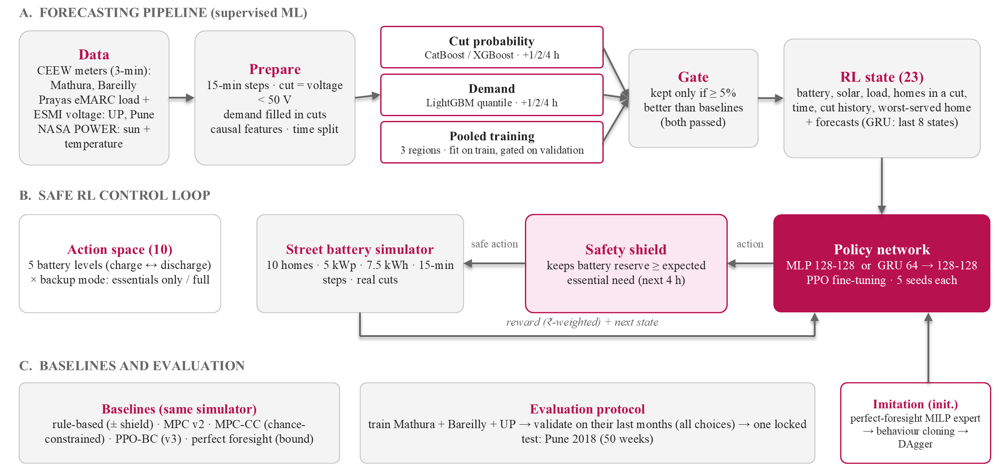
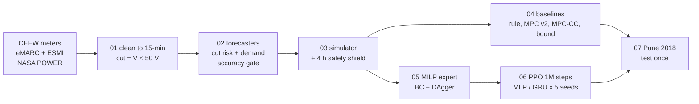
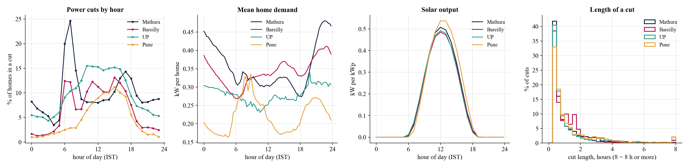
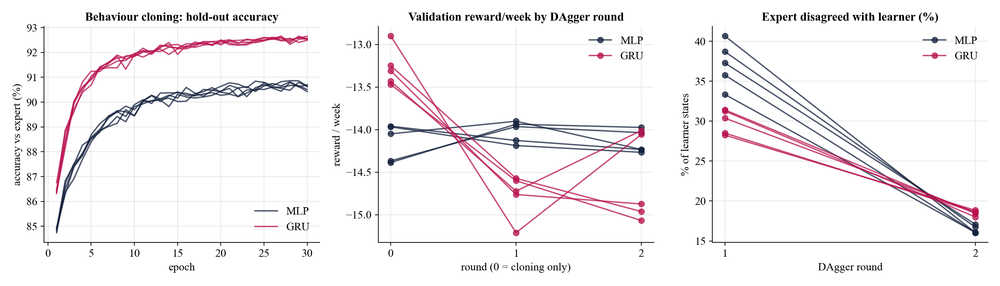
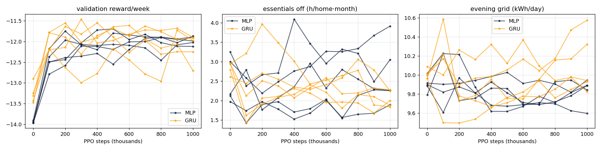
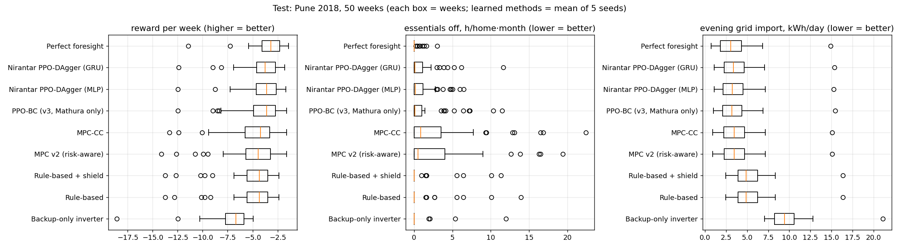

# Nirantar — Reinforcement Learning for Reliability-Constrained, Outage-Aware Community Battery Management

    

A PPO controller for a **solar + battery system shared by 10 homes** on a street with frequent, home-by-home power cuts. It is trained on **real measured
outage and load data from three Indian regions**, warm-started by **imitating a perfect-foresight optimiser (behaviour cloning + DAgger)**, kept safe by a
**4-hour safety shield**, and tested **once** on an unseen city (**Pune 2018**).

**🌐 Live website (interactive simulation + narrated video): https://lucky07-07.github.io/nirantar-reinforcement-learning/**



## RL simulation video
A 50-second animation of the frozen GRU-PPO controller running one real validation day (Bareilly): live power flows, the 10 homes and their cuts,
the policy's action probabilities, forecasts, the safety shield and the 24-hour trace — built from a recorded rollout
([`results/rl_simulation_rollout.csv`](results/rl_simulation_rollout.csv)) by [`scripts/generate_rl_simulation.py`](scripts/generate_rl_simulation.py).

▶ [**Report/yuva_yodha_rl_simulation.mp4**](Report/yuva_yodha_rl_simulation.mp4) (1920×1080, 30 fps, 50 s, narrated with Gnani Timbre text-to-speech)

## Key results (Pune 2018, 50 test weeks, run once)

| | Final controller (GRU) vs rule-based | vs chance-constrained MPC | vs our earlier PPO-BC |
|---|---|---|---|
| Reward / week | **+0.93** [+0.74, +1.19] | **+0.87** [+0.54, +1.26] | +0.10 [−0.01, +0.22] (n.s.) |
| Evening grid import (kWh/day) | **−1.58** [−1.72, −1.47] | −0.13 [−0.30, +0.03] (n.s.) | +0.13 [+0.10, +0.15] |
| Essential-load hours lost (h/home·month) | +0.17 [−0.28, +0.49] (n.s.) | **−2.19** [−3.31, −1.25] | **−0.38** [−0.77, −0.07] |
| Pre-registered question | **Q1: YES** | **Q2: YES** | **Q3: NO** |

- Closes **57.6%** of the gap between rule-based control and the perfect-foresight bound; score 94/100 (rule-based and MPC: 85).
- All 15 learned policies (5 PPO-BC, 5 MLP, 5 GRU) beat rule-based control on reward.
- Honest negatives: **DAgger** improved agreement with the expert but not reward; the **GRU** (chosen on validation) is slightly *worse* than the MLP on the test (−0.09 [−0.15, −0.03]).

## Contents
[Problem](#problem-and-objectives) · [Pipeline](#pipeline) · [Data](#dataset) · [MDP](#mdp-and-reward) · [Learning](#learning-bc--dagger--ppo-mlp-vs-gru) ·
[Results](#results) · [Reproduce](#setup-and-reproduction) · [Structure](#repository-structure) · [Limitations](#limitations) · [References](#references)

## Problem and objectives
Grid supply in Indian towns is interrupted every day: a home loses supply for **2.19 h/day in Mathura** and
**1.68 h/day in Bareilly**, mostly in short cuts, and usually only 12–14% of a street's homes are cut at the same time.
A shared street battery can therefore cover the few homes in a cut. Every 15 minutes the controller decides how to charge, discharge and allocate backup power
so that **essential loads stay on**, while **evening grid import, battery wear and unfairness** stay low — using only information available at that moment.

1. **Forecast** per-home cut probability and demand (+1/+2/+4 h) and admit them only if ≥ 5% better than simple baselines (both passed).
2. **Learn** a safe policy: perfect-foresight MILP expert → behaviour cloning → DAgger → PPO behind a shield; **MLP vs GRU**, 5 seeds each.
3. **Compare** with rule-based control (± shield), MPC v2, chance-constrained MPC, our earlier PPO-BC and the perfect-foresight bound.
4. **Evaluate without leakage**: hash-locked plan, validation-only selection, one test on Pune 2018 with paired 95% bootstrap CIs.

## Pipeline

Every notebook checks the SHA-256 of the locked plan (`results/FINAL_SPEC.md`); models are hashed into `results/freeze.json` before the Pune data is
turned into episodes, and notebook 07 refuses a second run.

## Dataset
| Region | Role | Source | Homes | Period | Home-steps (15-min) | Readings present (%) | Cut h/home·day | Weeks (train + val) |
|---|---|---|---|---|---|---|---|---|
| Mathura | Train + validation | CEEW smart meters (3-min energy + voltage) | 38 | May 2019 – Feb 2021 | 2,414,976 | 65 | 2.19 | 374 + 17 |
| Bareilly | Train + validation | CEEW smart meters (3-min energy + voltage) | 46 | May 2019 – Oct 2021 | 4,005,312 | 67 | 1.68 | 486 + 43 |
| Uttar Pradesh | Train + validation | Prayas eMARC load (15-min) + ESMI voltage (4 sites) | 36 | Jan – Dec 2019 | 1,261,440 | 94 | 2.37 | 120 + 13 |
| Pune | Test only | Prayas eMARC load + ESMI voltage (3 sites) | 44 | Jan – Dec 2018 | 1,541,760 | 96 | 1.11 | 50 (test) |
| Total |  | + NASA POWER hourly solar and temperature | 164 |  | 9.2 M |  |  | 980 + 73 + 50 |

- **Sources (public, CC0):** CEEW smart meters, Harvard Dataverse doi:10.7910/DVN/GOCHJH · Prayas eMARC doi:10.7910/DVN/YJ5SP1 · Prayas ESMI doi:10.7910/DVN/CLLZZM · NASA POWER hourly solar/temperature.
- **Preprocessing:** a 15-min slot is a **cut** if ≥ half of its voltage readings are < 50 V; **missing readings (NaN) are not cuts**; load and demand are in **kW**;
  demand during a cut is imputed with the home's mean load at the same slot and month; NASA hourly data shifted +30 min, UTC → IST, performance ratio 0.75.
- **Split:** 980 sliding 7-day training windows · 73 validation weeks (last months of each region) · 50 Pune test weeks. 1 step = 15 min, 1 episode = 1 week = 672 steps.

**Sample rows** — Mathura home MH01, 6 June 2019 (\* = imputed demand during a cut; verified equal to the home × month × slot mean):

| Time (IST) | Cut (V < 50) | Metered load (kW) | Demand used (kW) | Solar (kW/kWp) | Irradiance (W/m²) | Temp (°C) |
|---|---|---|---|---|---|---|
| 18:45 | 0 | 0.008 | 0.008 | 0.025 | 33.6 | 43.5 |
| 19:00 | 0 | 0.072 | 0.072 | 0.007 | 9.5 | 43.0 |
| 19:15 | 1 | – (cut) | 0.129 * | 0.005 | 7.1 | 42.7 |
| 19:30 | 1 | – (cut) | 0.122 * | 0.004 | 4.8 | 42.4 |
| 19:45 | 0 | 0.060 | 0.060 | 0.002 | 2.4 | 42.0 |
| 20:00 | 0 | 0.088 | 0.088 | 0.000 | 0.0 | 41.7 |

**EDA:** about half of all cuts last ≤ 30 min (52–58%), 96–99% end within 6 h; the worst cut hour differs by region (Mathura 07:00, Bareilly/Pune ≈15:00);
demand peaks after sunset while solar peaks at noon; Pune has only 1.11 cut h/home·day (training regions 1.7–2.4).



## MDP and reward
**State (23 causal features; the GRU sees the last 8 states = 2 h):**

| Group | Features | Count |
|---|---|---|
| Battery and solar | battery state of charge; solar in the last completed hour; solar at the same time 24 h earlier | 3 |
| Demand | load of homes with supply; essential need of homes in a cut; total demand of homes in a cut; share of homes in a cut | 4 |
| Time | sine and cosine of time of day; sine and cosine of day of week | 4 |
| Cut pattern | past-7-day street cut rate at this time of day: now, +1 h, +2 h | 3 |
| Fairness | share of cut demand served so far for the worst-served home of the week | 1 |
| Forecasts | cut probability +1/+2/+4 h; expected essential shortfall +1/+2 h; demand forecast +1/+2/+4 h | 8 |
| Total | the MLP sees these 23 numbers; the GRU sees the last 8 steps (2 h), i.e. 8 × 23 | 23 |

**Actions (10):** battery level u ∈ {−1, −0.5, 0, 0.5, 1} × backup mode m ∈ {essentials only, full}. Episode = 672 steps; training resets draw a random
window, 10 random homes and a random start charge (30–90%); validation/test use fixed homes and 50% charge.

**Reward** (per 15-min step, κ = 0.1):

```
r_t = −κ · ( 10·Σ_i U_ess(i,t) + 3·Σ_i U_other(i,t) + 0.2·P_dis·Δt + [ G_t + 3·max(G_t − 5.76 kW, 0) ]·Δt·1[18–22 h] )
r_T += κ · 5 · n · (J − 1)          J = Jain fairness of the homes' served share of cut demand
```
**Shield:** before each action, the expected essential need of the next 4 h (from the forecasts) is compared with the usable stored energy; discharge is cut,
backup falls back to essentials, or the battery charges from the grid (outside 18–22 h) when the reserve is short.

## Learning: BC → DAgger → PPO (MLP vs GRU)
| Stage | What happens | Episodes (weeks) | Steps / samples | Time |
|---|---|---|---|---|
| Expert demonstrations | perfect-foresight MILP, re-planned every 4 h | 980 | 658,560 state–action pairs | 24 min (8 cores) |
| Behaviour cloning | cross-entropy, Adam 1e-3, batch 1,024, 30 epochs, GPU | 980 | 658,560 × 30 epochs | 32–38 min/seed (with DAgger) |
| DAgger (2 rounds) | policy drives, expert labels every 8th reached state | 300 / round | 201,600 steps → ≈25,200 labels / round | – |
| PPO | lr 1e-4, n_steps 2,048, batch 256, 10 epochs, clip 0.2, ent 0.01, γ 0.995, λ 0.95, shield on | ≈1,488 / run | 1,000,000 / run | MLP 31 min, GRU 52 min |
| Validation | every 100k steps incl. step 0 (11 checkpoints) on 73 weeks | 803 / run | – | – |
| **Total** | MLP + GRU × seeds 0–4 | **≈14,880** | **10 M PPO steps** | ≈1.5 h (5 runs in parallel) |

- **MLP:** state (23) → 128 → 128. **GRU:** last 8 states (8 × 23) → GRU(64) → concat current state → 128 → 128.
- Cloning hold-out accuracy ≈ 92.5% (GRU) and ≈ 90.6% (MLP).

| Net | Round | Hold-out acc. (%) | Expert disagreed (%) | Labels added | Val. reward/week | Ess. off |
|---|---|---|---|---|---|---|
| GRU | 0 | 92.6 | – | – | -13.27 ± 0.23 | 2.85 |
| GRU | 1 | 92.0 | 30.0 | 25,200 | -14.77 ± 0.26 | 2.48 |
| GRU | 2 | 91.5 | 18.5 | 25,200 | -14.59 ± 0.52 | 2.20 |
| MLP | 0 | 90.8 | – | – | -14.15 ± 0.21 | 3.11 |
| MLP | 1 | 90.2 | 37.2 | 25,200 | -14.02 ± 0.13 | 2.03 |
| MLP | 2 | 89.9 | 16.4 | 25,200 | -14.15 ± 0.13 | 1.90 |



**PPO validation curves (all 10 runs):** reward jumps from ≈ −13.9 (MLP) / −13.3 (GRU) to ≈ −12.2 in the first 100k steps and then plateaus between
−11.5 and −12.5 (one GRU seed dips to ≈ −13 between 300k and 800k before recovering), so the best checkpoint (200k–1M) is kept. Essentials off stays noisy
(1.5–4 h; one MLP seed drifts to ≈ 3.9 h at 1M; chosen GRU checkpoints average 2.11 h) and evening import stays within 9.5–10.6 kWh/day.



## Results
**Validation (73 weeks; selection only):**

| Method | Reward/week ↑ | Essentials off ↓ | Served (%) | Evening grid ↓ | Note |
|---|---|---|---|---|---|
| No system | -38.55 | 53.38 | 0.0 | 14.62 |  |
| Solar only | -25.38 | 22.35 | 50.1 | 14.59 |  |
| Backup-only inverter | -16.84 | 1.95 | 95.1 | 15.85 |  |
| Rule-based | -15.11 | 3.32 | 88.5 | 12.26 |  |
| Rule-based + shield | -14.79 | 2.27 | 88.5 | 12.27 |  |
| MPC v2 (risk-aware) | -16.73 | 4.46 | 72.8 | 11.42 |  |
| MPC-CC (ε = 0.20) | -15.51 | 4.71 | 79.6 | 11.47 |  |
| MPC-CC (ε = 0.10) | -15.47 | 4.46 | 79.6 | 11.45 | chosen ε* |
| MPC-CC (ε = 0.05) | -15.47 | 4.42 | 79.4 | 11.46 |  |
| Imitation only (MLP) | -13.95 ± 0.03 | 2.50 ± 0.58 | 75.5 | 9.90 | rounds kept: 0, 1, 1, 0, 1 |
| Imitation only (GRU) | -13.27 ± 0.23 | 2.85 ± 0.15 | 81.5 | 10.00 | rounds kept: 0, 0, 0, 0, 0 |
| PPO-DAgger (MLP) | -11.84 ± 0.11 | 2.53 ± 0.98 | 90.4 | 9.87 | compared on test |
| PPO-DAgger (GRU) | -11.58 ± 0.10 | 2.11 ± 0.17 | 91.3 | 9.88 | final controller |
| Perfect foresight (bound) | -9.66 | 0.77 | 95.6 | 9.52 | knows the future |

**Pune 2018 test (50 weeks, run once; learned methods = mean of 5 seeds; ★ final controller):**

| Method | Essentials off (h/home·mo) ↓ | Cut demand served (%) ↑ | Evening grid (kWh/day) ↓ | Cycles/day | Jain ↑ | Wear (₹/home·mo) | Shield (%) | Reward/week ↑ | Score (0–100) |
|---|---|---|---|---|---|---|---|---|---|
| No system | 30.70 | 0.0 | 9.43 | 0.00 | – | 0.0 | 0.0 | -14.27 | 0 |
| Solar only | 7.80 | 65.4 | 9.29 | 0.00 | 0.892 | 0.0 | 0.0 | -9.64 | 42 |
| Backup-only inverter | 0.43 | 98.0 | 9.60 | 0.10 | 0.999 | 2.6 | 0.0 | -7.15 | 65 |
| Rule-based | 0.89 | 93.3 | 5.20 | 0.63 | 0.988 | 16.6 | 0.0 | -4.97 | 85 |
| Rule-based + shield | 0.78 | 93.3 | 5.20 | 0.63 | 0.988 | 16.6 | 0.0 | -4.96 | 85 |
| MPC v2 (risk-aware) | 3.04 | 80.0 | 3.73 | 0.80 | 0.952 | 21.2 | 2.9 | -5.00 | 85 |
| MPC-CC (ε = 0.10) | 3.25 | 82.4 | 3.75 | 0.79 | 0.948 | 21.1 | 0.0 | -4.91 | 86 |
| PPO-BC (v3, Mathura only) | 1.43 | 90.5 | 3.49 | 0.85 | 0.980 | 22.6 | 2.3 | -4.14 | 93 |
| Nirantar PPO-DAgger (MLP) | 1.05 | 93.5 | 3.55 | 0.85 | 0.989 | 22.7 | 1.3 | -3.95 | 95 |
| **Nirantar PPO-DAgger (GRU) ★** | 1.05 | 93.5 | 3.62 | 0.90 | 0.988 | 24.0 | 2.6 | -4.04 | 94 |
| Perfect foresight (bound) | 0.19 | 98.5 | 3.27 | 0.91 | 0.999 | 24.0 | 0.0 | -3.36 | 100 |

**Pre-registered questions (paired per week, 95% bootstrap CI, 10,000 resamples):**

| Comparison (final − other) | Reward/week | Essentials off | Evening grid | Cut demand served | Verdict |
|---|---|---|---|---|---|
| Q1: GRU − Rule-based | +0.93 [+0.74, +1.19] | +0.17 [-0.28, +0.49] | -1.58 [-1.72, -1.47] | +0.21 [-1.18, +1.78] | YES |
| Q2: GRU − MPC-CC | +0.87 [+0.54, +1.26] | -2.19 [-3.31, -1.25] | -0.13 [-0.30, +0.03] | +11.12 [+7.69, +14.76] | YES |
| Q3: GRU − PPO-BC (v3) | +0.10 [-0.01, +0.22] | -0.38 [-0.77, -0.07] | +0.13 [+0.10, +0.15] | +3.00 [+1.85, +4.23] | NO |
| GRU − MLP | -0.09 [-0.15, -0.03] | +0.01 [-0.21, +0.28] | +0.06 [+0.04, +0.08] | +0.03 [-0.46, +0.56] | MLP better |



<details><summary>Per-seed test results</summary>

| Method | Seed | Ess. off | Served (%) | Evening grid | Cycles/day | Reward/week | Beats rule? |
|---|---|---|---|---|---|---|---|
| PPO-BC (v3) | 0 | 1.60 | 88.7 | 3.46 | 0.85 | -4.26 | yes |
| PPO-BC (v3) | 1 | 1.63 | 92.0 | 3.43 | 0.86 | -3.99 | yes |
| PPO-BC (v3) | 2 | 1.15 | 91.3 | 3.48 | 0.85 | -4.06 | yes |
| PPO-BC (v3) | 3 | 1.67 | 87.5 | 3.49 | 0.84 | -4.38 | yes |
| PPO-BC (v3) | 4 | 1.12 | 93.2 | 3.59 | 0.85 | -4.03 | yes |
| PPO-DAgger MLP | 0 | 1.15 | 94.3 | 3.65 | 0.84 | -3.94 | yes |
| PPO-DAgger MLP | 1 | 0.84 | 94.4 | 3.53 | 0.86 | -3.89 | yes |
| PPO-DAgger MLP | 2 | 0.93 | 92.8 | 3.56 | 0.86 | -4.03 | yes |
| PPO-DAgger MLP | 3 | 1.41 | 92.5 | 3.46 | 0.87 | -3.97 | yes |
| PPO-DAgger MLP | 4 | 0.92 | 93.6 | 3.57 | 0.85 | -3.94 | yes |
| PPO-DAgger GRU | 0 | 1.33 | 92.9 | 3.47 | 0.92 | -4.02 | yes |
| PPO-DAgger GRU | 1 | 1.14 | 94.1 | 4.03 | 0.87 | -4.28 | yes |
| PPO-DAgger GRU | 2 | 0.88 | 93.7 | 3.46 | 0.87 | -3.86 | yes |
| PPO-DAgger GRU | 3 | 0.90 | 93.6 | 3.44 | 0.87 | -3.88 | yes |
| PPO-DAgger GRU | 4 | 1.03 | 93.4 | 3.70 | 1.00 | -4.17 | yes |
</details>

## Setup and reproduction
```bash
python -m venv .venv
.venv\Scripts\activate          # Windows  (source .venv/bin/activate on Linux/macOS)
pip install -r requirements.txt
```
1. Download the public data into `data/raw/` (`ceew/`, `emarc/`, `esmi/`, `nasa/`) from the DOIs above (eMARC/ESMI require accepting the Dataverse guestbook).
2. Run the notebooks in order (each one writes its outputs to `results/`, `models/` or `src/`):
```bash
cd notebooks
jupyter nbconvert --to notebook --execute --inplace 00_plan_lock.ipynb   # then 01 … 07 in order
```
Hardware used: Intel i5-10300H (4 cores / 8 threads), 16 GB RAM, RTX 2060 6 GB (behaviour cloning only); PPO runs on the CPU. Notebook 07 runs the test once;
later runs only re-read the hash-checked results. The frozen final PPO checkpoints (`models/rl/`) and forecasters (`models/forecasters.pkl`) are included;
the reference PPO-BC (v3) models and raw data are not.

## Repository structure
```
notebooks/   00_plan_lock … 07_test_pune   (the whole pipeline; .ipynb only)
src/         sim.py (simulator + shield) · planners.py (MILP) · controllers.py (baselines, expert) · features.py · learn.py (BC, DAgger, PPO, GRU)
results/     FINAL_SPEC.md (locked plan) · FINAL_RESULTS.md · *.csv / *.json results · figures/
models/      forecasters.pkl · rl/{MLP,GRU}_s{0..4}/best_model.zip
data/        processed/split.json, episodes.json (raw and processed tables are not committed)
Report/      yuva_yodha_rl_simulation.mp4 (narrated simulation video)
scripts/     generate_rl_simulation.py (rollout of the frozen policy -> 50 s video)
deck/        DSC25023,15_RL_Project.pptx · Literature_Survey_Nirantar.xlsx
```

## Limitations
- Simulation only; no hardware. Cuts are inferred from supply voltage < 50 V; in UP and Pune, ESMI sites are paired with eMARC homes (not the same homes).
- Demand during cuts is imputed; one test city-year (Pune 2018) with fewer cuts than the training regions.
- Linear battery wear and constant efficiency; reward weights fixed in advance.

## References
1. J. Schulman et al., "Proximal policy optimization algorithms," arXiv:1707.06347, 2017.
2. S. Ross, G. J. Gordon, J. A. Bagnell, "A reduction of imitation learning and structured prediction to no-regret online learning," AISTATS, 2011.
3. D. A. Pomerleau, "ALVINN: An autonomous land vehicle in a neural network," NIPS, 1989; M. Bain and C. Sammut, "A framework for behavioural cloning," Machine Intelligence 15, 1999.
4. K. Cho et al., "Learning phrase representations using RNN encoder–decoder for statistical machine translation," EMNLP, 2014.
5. M. Alshiekh et al., "Safe reinforcement learning via shielding," AAAI, 2018.
6. J. Schulman et al., "High-dimensional continuous control using generalized advantage estimation," ICLR, 2016.
7. A. Raffin et al., "Stable-Baselines3: Reliable reinforcement learning implementations," JMLR 22(268), 2021.
8. R. Jain, D.-M. Chiu, W. R. Hawe, "A quantitative measure of fairness and discrimination for resource allocation in shared computer systems," DEC-TR-301, 1984.
9. CEEW smart-meter data (doi:10.7910/DVN/GOCHJH); Prayas eMARC (doi:10.7910/DVN/YJ5SP1) and ESMI (doi:10.7910/DVN/CLLZZM); NASA POWER.

The full literature survey (15 papers, 2024–2026) is in `deck/Literature_Survey_Nirantar.xlsx`.

## Authors
Anil Kumar (BL.SC.P2DSC25023) and Urmith Sai (BL.SC.P2DSC25015) — M.Tech, Amrita School of Computing, Bengaluru. Guide: Dr. Bharath K.P.
Course project for Reinforcement Learning (24DS742).
